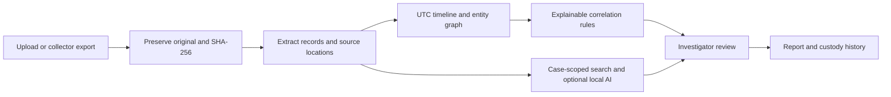

# Understand and test SutraTrace

## What the project does

SutraTrace helps an investigator connect previously acquired digital evidence. Its central question is: **what do these records support, and can I trace every finding back to the original?**

The React/TypeScript frontend is the investigator workspace. FastAPI receives files and owns the forensic operations. SQLite stores cases, extracted observations, findings, and custody entries. Original bytes are kept separately in the local vault. Ollama is an optional local generation service; ordinary searching and deterministic investigation continue without it.



The vault checks byte consistency. The timeline orders records when their timezone is known. Graph edges show shared field values with their source. Rules generate leads, not verdicts. The investigator reviews the leads and exports findings with the source trail and limitations.

## Run it

Double-click `Start-SutraTrace.cmd`, or run from `C:\SutraTrace`:

```powershell
.\.venv\Scripts\python.exe -m uvicorn backend.app:app --host 127.0.0.1 --port 8765
```

Open http://127.0.0.1:8765. Keep the terminal open. If a copy is already running, use that copy instead of starting another server.

## Ten-minute demo test

1. **Open Operation Silent Thread.** On an empty installation select Explore the demo case. Initially expect six files, 16 extracted records (12 timed and four text notes), 11 entities, and four findings. Three findings have high review priority. Review counts change after your decisions.
2. **Inspect the vault.** Open authentication.csv. Check the collector, acquisition time, intake SHA-256, and Verify bytes action. Expect verified. Open Original to download the preserved bytes.
3. **Filter the timeline.** Select network as the source. Expect a routine backup and an outbound transfer. Open the transfer: original time is `2026-10-16T21:19:00+05:30`, normalized time is `2026-10-16T15:49:00Z`, and the source is `network-traffic.csv / csv:record:2`.
4. **Explore the graph.** Select account `a.sharma`. Expect 12 linked source observations. Select an observation to inspect its raw fields. Shared fields are correlations, not proof of human identity.
5. **Review a finding.** Open Archive staging followed by outbound transfer. Inspect its evidence and limitations. Enter reasoning such as `Synthetic test: sequence is supported; payload identity remains unconfirmed.` Then accept the lead or mark it for follow-up. Run triage again: the review decision should remain.
6. **Ask the copilot.** Use `What evidence supports the transfer?`. In search mode expect source observations and clickable citations, including limitations from collection notes. Click the transfer citation. Ask `unicorn_987654_absent`: expect no supporting records, not an invented answer.
7. **Check custody.** Open Chain of custody and Verify chain. Expect internal consistency. Expanding entries shows actor, action, hashes, and details. A local internally consistent chain is not externally authenticated.
8. **Export a report.** Download Markdown and JSON. Your accepted finding should be in Accepted findings; other leads retain their separate statuses. Expect all six artifacts, hashes, observations, audit entries, and limitations.
9. **Check persistence.** Reload the page or restart the server. Case records and review decisions should still be present. This uses the local data directory, not browser-only storage.

All demo records are fictional. Changing review decisions in the demo changes only your local training case.

## Test your own synthetic files

Create a new case named `Parser practice`, enter an investigator and testing scope, then import files from `samples/`. Select the appropriate source category for each file. Use these files to check multi-source parsing without touching real evidence.

- Import the same file twice: separate evidence IDs, equal intake hashes, and a duplicate-byte review lead.
- Import malformed JSON such as `{invalid`: original bytes remain preserved and hashed; parser status says parse failed.
- Import a record with a timestamp lacking an offset: time remains unresolved, rather than guessing a timezone.
- Create a second empty case and search for an identifier found only in the first: expect no matching records.
- Use the automated tamper test rather than manually altering the live evidence vault. It changes an isolated test fixture and checks detection and export blocking.

## Automated tests

```powershell
cd C:\SutraTrace
.\.venv\Scripts\python.exe -m pytest -q
npm --prefix frontend run build
npm --prefix frontend run format:check
```

Expected result: 30 tests pass, the frontend compiles, and formatting passes. See [VERIFICATION.md](VERIFICATION.md) for actual coverage and limits.

## Where is the AI?

Without Ollama, the copilot uses case-scoped full-text retrieval and labels itself Evidence search. Correlation uses explicit rules; it is not a trained fraud classifier.

To test actual generation, install Ollama, download a suitable model, and set `SUTRATRACE_MODEL` to its exact installed name before starting the backend. Enable Use local AI in the copilot. The request goes only to the loopback Ollama endpoint. Test a supported question, an absent fact, an invalid response, and a stopped model service. Inspect sources and reasoning yourself; valid citations do not guarantee correct conclusions. Setup commands are in the main README.

## What to push after this verification pass

This pass adds model-adapter tests and the verification/testing guides. It does not change application behavior or your GitHub remote.

```powershell
cd C:\SutraTrace
git status --short
git add tests/test_forensics.py docs/VERIFICATION.md docs/TESTING.md
git diff --cached --stat
git commit -m "Add model adapter tests and verification guides"
git push origin main
```

No `git init` or new remote is needed: the repository is already configured. Real evidence and local test output remain ignored. If the remote has advanced, fetch/reconcile those changes instead of force-pushing.
